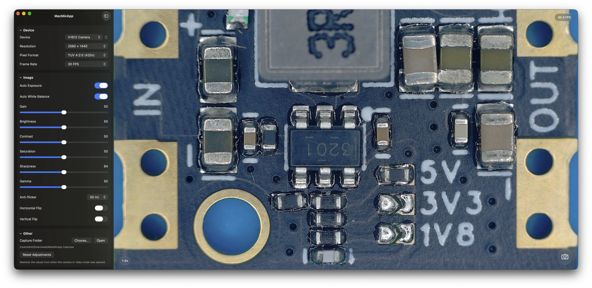

# MacMicApp

A native USB microscope app designed to be as simple and lightweight as possible for **macOS 27 and later on Apple Silicon**, built with SwiftUI, AppKit, and AVFoundation. View live video, adjust camera settings, and capture still images without third-party dependencies.

This project was developed for personal use with the help of **ChatGPT Codex**. It has only been tested with a **Yizhan microscope identified as H1612 Camera**. Compatibility with other microscopes has not been verified. Camera capture uses macOS APIs, while some control commands include device-specific handling for this model.



## Features

- Live video with separate device, resolution, pixel format, and frame rate selectors. All camera-reported formats are available, including formats with the same resolution and custom frame rates within supported ranges.
- Actual incoming FPS displayed over the video.
- Automatic and manual exposure and white balance, gain, brightness, contrast, saturation, sharpness, gamma, and anti-flicker controls, where supported by the camera.
- Current camera-reported exposure displayed beside Auto Exposure. Yizhan exposure is shown in device units, without an unverified conversion to milliseconds.
- Individual and combined adjustment resets restore the initial values of the current session or mode, rather than factory defaults.
- Horizontal and vertical flips applied to both the preview and saved images, remembered between sessions.
- Smooth, cursor-centered zoom from **1× to 8× in 0.1× steps**. Scroll over the image to zoom and drag with the left mouse button to pan. Click the zoom indicator or double-click the image to reset. Zoom is not saved between sessions.
- Full-resolution PNG capture using the camera button, **Space**, or **⌘S**, without blocking the preview. Saved images include flips but are not cropped by preview zoom or panning.
- Configurable capture folder, defaulting to `~/Downloads/MacMicApp Captures`, with a button to open it in Finder. Existing captures are not overwritten.
- Native sidebar with collapsible **Device**, **Image**, and **Other** sections, plus Liquid Glass controls and indicators over the video.
- Saved camera selection, confirmed video mode, window size, and window position. Native macOS full-screen support.
- Recovery handling for USB disconnection, sleep, and stream interruptions.

## Installation

MacMicApp is distributed as a **ZIP archive on [GitHub Releases](https://github.com/dotter-ak/MacMicApp/releases)**. The app uses ad-hoc signing and is not notarized by Apple. Xcode and Command Line Tools are not needed to use the prebuilt app.

To install:

1. Download and extract the ZIP from the [Releases page](https://github.com/dotter-ak/MacMicApp/releases).
2. Move `MacMicApp.app` to **Applications** and open it.
3. If macOS blocks it because the developer cannot be verified, open **System Settings → Privacy & Security → Open Anyway** after the initial launch attempt, then confirm opening MacMicApp.
4. Click **Allow Camera Access** in the app and approve the macOS permission request.

To update, quit the app and replace it with the new version. macOS may ask you to confirm opening the app or grant camera access again after an update. There is no need to disable Gatekeeper or remove quarantine attributes through Terminal. The instructions above apply to an unverified-developer warning; a damaged-app or malware warning requires separate investigation. See [Apple's instructions](https://support.apple.com/102445).

## Build and run

Requires Apple Command Line Tools with the **macOS 27 SDK** and Swift 6. Full Xcode is not required for the local build. Quit any running copy of MacMicApp, then run these commands from the project directory:

```sh
./scripts/build-local.sh Release
./scripts/run-local.sh Release
```

The app is created at `.local/build/Release/MacMicApp.app` and can also be opened from Finder. Release builds use compiler optimization and exclude DEBUG diagnostic probes. A separate `MacMicApp.app.dSYM` is generated for crash diagnosis.

For development:

```sh
./scripts/build-local.sh Debug
./scripts/run-local.sh Debug
```

Both scripts default to **Debug** when no configuration is specified. Debug and Release share the same app identifier and user settings; do not run them simultaneously with the same camera.

Build settings are in `Config/App.xcconfig`. The local build installs the validated, precompiled native icon resources from `Resources/CompiledIcon`. Changes to the `.icon` source require recompiling those resources. The existing app is replaced only after compilation, resource installation, and signature verification succeed.

To build and package a release in one command:

```sh
./scripts/package-release.sh
```

This rebuilds Release, checks the app version, architecture, and signature, and creates a ZIP containing the app and MIT license in `.local/build/Distribution`, together with a SHA256 checksum. The extracted app's signature is verified before the archive is published locally. An older ZIP with the same name is retained in the `previous` subfolder. Nothing is uploaded to GitHub automatically.

Focused checks are available as `./scripts/check-*.sh`, for example `./scripts/check-exposure.sh`. They share compiler settings and source groups through `scripts/lib/checks.sh` and do not require a connected microscope.

An optional full-Xcode build is available for environments with Xcode and the required SDK:

```sh
./scripts/build-native.sh Release
```

This compiles `MacMicApp/AppIcon.icon` and produces `.local/build/Native/Build/Products/Release/MacMicApp.app`.

## Camera permission and signing

On first launch, click **Allow Camera Access** and approve the system prompt. If access was denied, enable MacMicApp under **System Settings → Privacy & Security → Camera**, then return to the app or refresh the camera list.

Builds use **ad-hoc signing** by default. This ties the signing identity to the particular code build, so macOS may request permission again after a rebuild or update. Choosing Release does not change that behavior. The app does not use Developer ID signing or Apple notarization.

Optionally, an existing signing certificate in Keychain can be selected through `MACMIC_SIGN_IDENTITY`. A signing failure stops the build rather than silently falling back to ad-hoc signing.

App Sandbox and Hardened Runtime are enabled. The app uses camera and USB access, Downloads access, and user-selected folders. It does not request microphone access.

## License

MacMicApp is licensed under the [MIT License](LICENSE). You may use, modify, and distribute it, including commercially, provided you retain the copyright and license notice. The software is provided without warranty.
